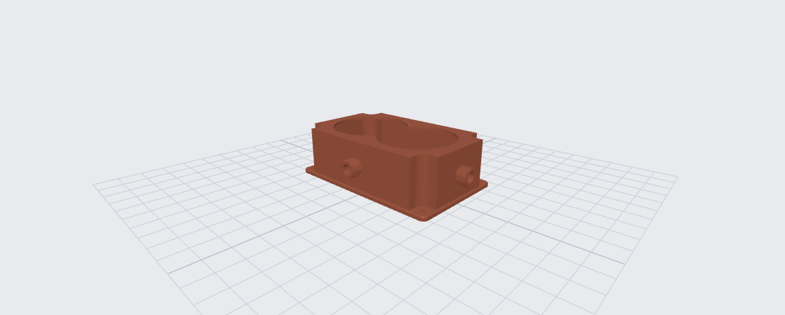
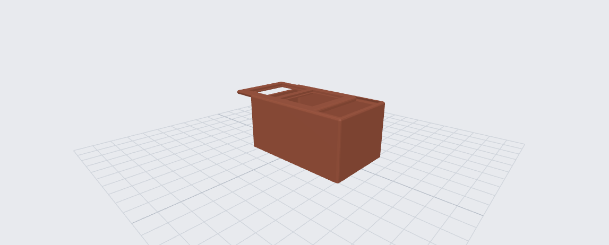

# Parametric OpenSCAD Models

This repository contains six configurable OpenSCAD projects and a browser-based playground for previewing, rendering, and exporting them. All model dimensions are in millimetres, and the models are self-contained without external OpenSCAD libraries.

## Online playground

Open the [live configurator](https://afinageny.github.io/drillbox/) and select a model from the file menu. The controls are generated from the parameter groups in each `.scad` file. Changes are reflected in the preview without changing the page URL. Use **copyUrl** to copy a shareable link containing the current code and parameters.

Direct links:

- [Drill plate and water cover](https://afinageny.github.io/drillbox/?file=drillbox.scad)
- [Sliding-lid storage box](https://afinageny.github.io/drillbox/?file=lidbox.scad)
- [Shuttlecock tube](https://afinageny.github.io/drillbox/?file=shuttlecock_tube.scad)
- [Tile scoring carriage](https://afinageny.github.io/drillbox/?file=tile_carriage.scad)
- [Tile scoring carriage — next version](https://afinageny.github.io/drillbox/?file=tile-carriage-next.scad)
- [Tile cutter carriage variant](https://afinageny.github.io/drillbox/?file=tile-cutter.scad)

Use **Preview** while adjusting parameters, **Render** for final geometry, **STL** to export the currently selected part, and **PNG** to save the current camera view.

## Models

### Drill plate and water cover

File: [`openscad/drillbox.scad`](openscad/drillbox.scad)



A matched drilling template and raised water cover for one or more circular openings. The cover includes two G 1/2 threaded ports, with matching printable hose and drain fittings.

Available parts:

- `assembly` — all parts arranged for inspection.
- `drillTemplate` — plate with the main openings and four corner mounting holes.
- `waterCover` — hollow raised cover with top openings and two threaded ports.
- `hoseFitting` — G 1/2 female fitting with 22 mm and 19 mm hose barbs.
- `drainPlug` — hexagonal G 1/2 female plug.

Main parameters control the hole count and spacing, plate margins and fillets, cover height and wall thickness, and hose fitting dimensions. Set `show_threads` to `false` for a faster simplified preview.

### Sliding-lid storage box

File: [`openscad/lidbox.scad`](openscad/lidbox.scad)



A rounded storage box with a two-piece sliding sandwich lid. The lid halves use matching trapezoidal profiles and alignment pegs, and can hold transparent sheet inserts in configurable window openings.

Available parts:

- `print` — box and both lid halves laid out for printing.
- `assembly` — closed or partially opened box preview.
- `box` — box body only.
- `lidSandwichTop` — upper lid half in its printing orientation.
- `lidSandwichBottom` — lower lid half in its printing orientation.

Use `lid_open` to inspect the sliding action. The box size, wall thickness, lid clearance, window grid, sheet thickness, and internal divider grid are all configurable. A small calibration print is recommended before committing to a large box because the best sliding clearance depends on the printer and material.

### Shuttlecock tube

File: [`openscad/shuttlecock_tube.scad`](openscad/shuttlecock_tube.scad)


A protective tube for badminton shuttlecocks with identical screw caps at both ends. The default body is 210 mm long with a 70 mm clear bore. Spiral ribs continue smoothly from the body across the rounded caps, while each cap retains a flat standing area.

Available views and parts:

- `assembly` — closed tube with both caps installed.
- `exploded` — caps separated by the `explosion` distance.
- `print` — tube and two caps arranged for printing.
- `tube` — tube body only.
- `cap` — one cap in its printing orientation.
- `cap_detail` — one cap with its local opening at Z = 0.
- `thread_test` — a short neck and matching cap for checking thread fit.

The body diameter, length, wall, wave count, wave depth, twist rate, and twist distribution are configurable. Thread pitch, depth, and clearances can be tuned for a specific printer. Cap controls adjust the rounded end, spiral grooves, standing diameter, and the internal head pocket. `cap_headroom_height` reserves extra space for the cork head and blends the pocket directly into the threaded cavity.

### Tile scoring carriage

File: [`openscad/tile_carriage.scad`](openscad/tile_carriage.scad)

A compact, hand-pressed three-point carriage for scoring a large tile alongside a rectangular guide rule. Two matching front wheels and a rear scoring disc contact the tile. The rounded upper shell and perimeter skirt form one continuous body, with the same rounded outline carried down the skirt and a rounded upper edge. Viewed from below, a narrow U-shaped rear skirt wraps around the cutter and opens toward the rear so the cutter is visible from behind. Tapered ties connect the U to the side skirts. Wheels and cutter ride on smooth, separate axle pins that press upward from below into snap-fit fork seats. Integral heads on each axle end keep it from sliding sideways, and the washers are separate parts. The preview omits the tile so the carriage underside remains visible. Select whether the rule is on the left, right, or both sides. The browser preview colors the rule, carriage, wheels, cutter, washers, and axles separately, with each color adjustable in the customizer.

The rule defaults to 50 × 10 mm, the front wheels to 20 mm diameter, and the cutting line to the middle of the 55 mm carriage width. Wheel and cutter dimensions, guide clearance, skirt clearance, top edge radius, corner radius, and axle/fork sizes are editable in the browser customizer. The body and guide are conceptual first-pass geometry; verify the actual cutter and wheel dimensions before printing a functional part.

### Tile scoring carriage — next version

File: [`openscad/tile-carriage-next.scad`](openscad/tile-carriage-next.scad)

The current ergonomic revision is 80 mm wide with a 40 mm scoring offset, 46 mm front wheel center spacing and an M8 × 75 front axle. An integral, sharp-edged palm rest rises 16 mm above the deck; its 32 × 20 mm upper landing is centered on the cutting line, 14 mm ahead of the cutter axle. Vertical pressure at that center ideally puts 86% of the load on the cutter (100 mm axle spacing); actual hand pressure and guide forces change that split. The inverted body print layout now requires supports beneath the deck around the raised rest. Set `pressure_grip_height = 0` to restore the flat top and its previous printing orientation. Geometry compiles, but ergonomics and load capacity still require a physical trial.

Current prototype changes: front wheel centers are 31 mm apart, with a 7.8 mm printed journal. Wheel and cutter washers are 2 mm thick; their pockets have no additional axial clearance. The 20 × 5 mm magnets have 4.5 mm through holes and 10 mm countersinks, and use metal M4 × 12 countersunk screws with rear-access M4 nut pockets. Metal magnet fasteners are omitted from print layouts. End magnets sit on projecting ears beyond the front and rear end bands, with at least 3 mm between their pockets and the axle passages; the optional center magnet remains between the side bearings. These prototype settings supersede the older dimensions below and still need physical fit checks.

The next version uses identical 22 mm outside diameter, 7 mm width and 8 mm bore bearings for the two support wheels and two side rollers. Their dimensions share the bearing_diameter, bearing_width and bearing_bore parameters. The rectangular body is 114 mm long, 62 mm wide and has a 10 mm upper plate, with 2 mm rounding on the upper edges and vertical corners. Side skirt walls are 3 mm thick; front and rear bands are 14 mm thick. The skirt and magnet holders keep 3 mm of tile clearance; the support wheels and cutter touch the same tile plane. The scoring offset is 30 mm to the near face of the rule at zero guide_clearance. The rule defaults to 50 mm wide and 20 mm high.

The side bearings sit under the skirt at Y = -28 and +24 mm (52 mm apart), on rectangular mounting blocks with 3 mm transverse reinforcing ribs enabled by default. The side walls run above the bearings with 0.5 mm clearance. The bearings and magnets are centered at Z = 10 mm, halfway up the rule. Side-bearing blocks have matching blind printed threads, 14 mm deep. Their plastic screws and the front wheel axle share nominal M8 × 1.25 metric threads, controlled by the Shared bearing screw threads group. Pitch fixes the ISO profile depth; bearing_thread_clearance and bearing_thread_axial_clearance adjust the printed female fit. Side screws retain separate 7.6 mm smooth bearing journals. Their 0.5 mm lower washers are separate printable parts, so they can also be used with metal screws. The side_front_gap and side_rear_gap parameters set the projected longitudinal wheel-to-roller gaps.

The scoring wheel defaults to 22 mm outside diameter, 6 mm width, a 6 mm bore and an 8 mm bearing-contact diameter.

The main wheel and cutter axes are 100 mm apart. Each 22 mm disc projects 4 mm beyond the 114 mm body, giving a 122 mm total wheel envelope. Wheel pockets and closed axle bores are built into the end bands. Plastic screw axles enter from the side opposite the rule, with one hex head, a smooth shank and a custom printed thread at the far end. The front axle uses M8 × 1.25 while retaining its 7.5 mm smooth journal; the rear cutter axle uses M6 × 1 with a separate 5.5 mm smooth journal. All threads have the ISO metric 60-degree profile, P/8 external crests and rounded external roots. Nominal profile geometry is based on ISO 68-1; the model uses explicit print fit offsets rather than implementing an ISO tolerance class. Insert the wheels and washers from below, then screw the axles in from the side. Use axle_print for the screw print layout. With guide_side set to both, remove the left rule for screw access.

Three optional magnets are enabled by default: two in separate corner blocks at Y = -49 and +44 mm, and one centered between the side bearings at Y = -2 mm. The corner magnets spread attraction over 93 mm. The front block is inset 6 mm from the support-wheel axle to avoid crossing its screw; magnet_front_corner_inset and magnet_rear_corner_inset adjust the positions. The Magnets group defaults to 10 mm diameter, 3 mm thickness, a 3 mm through-hole, a 6 mm countersink and a 45-degree wall angle to the axis (90-degree included cone). Hole dimensions are estimates from the reference photo. Magnets load from the rule side and are retained with printed countersunk screws: 2.7 mm smooth shank, 3 mm thread length and M3 × 0.5 thread by default. Magnet faces are recessed 0.1 mm behind the body, leaving 1.6 mm to the rule. The holders extend to the upper plate and maintain at least 3 mm tile clearance. Use enable_magnets to omit them, magnets or magnet_screws to inspect, and magnet_screws_print for printing the screws. Thread fit, screw strength and holding force need a physical trial.

Select `part = "print"` to arrange all printed parts: the body with its flat top on the bed, two upright screw axles, six wheel/cutter washers, two separate lower side-bearing washers, two side-bearing screws and three magnet screws (16 pieces by default). The 8 mm layout gap is controlled by print_gap. Bearings, magnets, cutter and rule are omitted. All pieces touch Z = 0; the default layout occupies about 142 × 114 mm with 63 mm maximum height. The layout adapts to both guide sides, disabled magnets and extra cutter spacers. The print preview preserves part colors.

Wheel axles and side-bearing screws share the `axle_head_thickness` head height (3 mm). Thickening the side heads extends them downward without moving their bearing journals or threads; the default tile clearance under them is 3 mm. Magnet screw heads remain countersunk to match the magnets.

The front wheels and cutter have separate bearing-contact diameters: `front_wheel_bearing_diameter` (12 mm by default) and `cutter_bearing_diameter` (8 mm by default). Each must exceed its bore diameter and remain below its wheel outside diameter. Their washers (and any cutter spacers) use exactly the same outside diameters; the former independent 16 mm washer diameter is removed. These controls describe the inner bearing contact zones, leaving wheel outside diameters and bores unchanged. The print layout adapts to the washer sizes.

The Metric thread printing group controls male radial compensation: 0.1 mm by default, giving actual printed thread crests of 7.8 mm, 5.8 mm and 2.8 mm for M8, M6 and M3. Set it to zero for nominal external geometry. Female print clearances are controlled per family. Thread sizes and pitches follow the [Accu metric thread table](https://i.accu.co.uk/documents/marketing/Thread-Size-Sheet-V2.pdf); profile dimensions follow the ISO geometry summarized in the [Bossard metric profile calculator](https://website-assets.bossard.com/Metric-Thread-Profile/Metric-thread-profile-calc-en.html). Trial printing is needed to set fit for a particular printer.

The Standard screw lengths group defaults to front M8 × 60 and the cutter-kit rear M6 × 33 bolt (length under the head), side M8 × 20 (under the head), and magnet M3 × 6 countersunk screws (overall length). Thread engagement sections are 6.7, 5, 12 and 3 mm respectively. Blind holes leave at least 0.5 mm at the tip. Wheel axle passages and washers clear nominal 8 mm and 6 mm metal shanks. Main metal axles may use hexagon heads; side metal screws require low button heads such as ISO 7380-1, 14 mm diameter and 4.4 mm height for M8, leaving 1.6 mm tile clearance with the supplied 0.5 mm washers. Tall socket heads are unsuitable for those side positions. Magnet heads must fit the actual countersink; DIN 965/963 style M3 heads up to 6 mm diameter are the intended type. Metal shafts avoid reliance on printed shafts under hand pressure, but the plastic body and thread strength still require physical load testing. Example fasteners: M8 × 60, the supplied M6 × 33 cutter bolt, [M8 ISO 7380-1](https://nederland.bossard.com/en-us/standard-fastening-elements/screws/screws-and-bolts-with-internal-drive/ulsx000z0080020).

The body is widened by 5 mm on the side opposite the active rule (body_free_side_extension) to accommodate the common M8 × 60 front axle without changing the 30 mm cut offset. Its total width is 62 mm. The supplied M6 × 33 cutter bolt seats in a 12.5 mm diameter, 10.025 mm deep head pocket on the free side, preserving 5 mm of printed thread engagement. The pocket depth adapts to the selected bolt length; a sufficiently long bolt seats on the outside wall. The cutter axis and wheel positions stay fixed. The front screw has 6.7 mm of thread engagement section and 0.5 mm bottom clearance; print layouts and left-rule geometry follow the asymmetric extension.

### Tile cutter bearing trolley

File: [`openscad/tile-cutter.scad`](openscad/tile-cutter.scad)

This is a shape-only prototype of the first trolley piece. It sits directly on the rectangular guide and follows the reference top outline: a central plate as wide as the guide, narrower tabs at both ends, and short side wings. The plate is 10 mm thick by default; guide and outline dimensions are adjustable in the customizer. Wheels and their fasteners are intentionally omitted at this stage.

## Printing workflow

1. Select an individual part or a print layout in the `part` control.
2. Adjust the dimensions and clearances for the intended printer and material.
3. Use **Render** before exporting complex threads or high-detail wave surfaces.
4. Export the result with **STL** and slice it in the normal way.

For the shuttlecock tube, print `thread_test` first and adjust `radial_clearance` and `axial_clearance` if necessary. The two caps are identical, so the same exported cap STL is used twice.

## Local development

Requirements:

- Node.js 22 or newer
- npm

Install dependencies and start the playground:

```bash
npm ci
npm run dev
```

Then open <http://127.0.0.1:5173/>. The development server watches the files in `openscad/` and reloads the selected model when it changes.

Run the production checks and build with:

```bash
npm run build
```

The GitHub Pages workflow publishes the `dist/` directory after each push to `master`.
